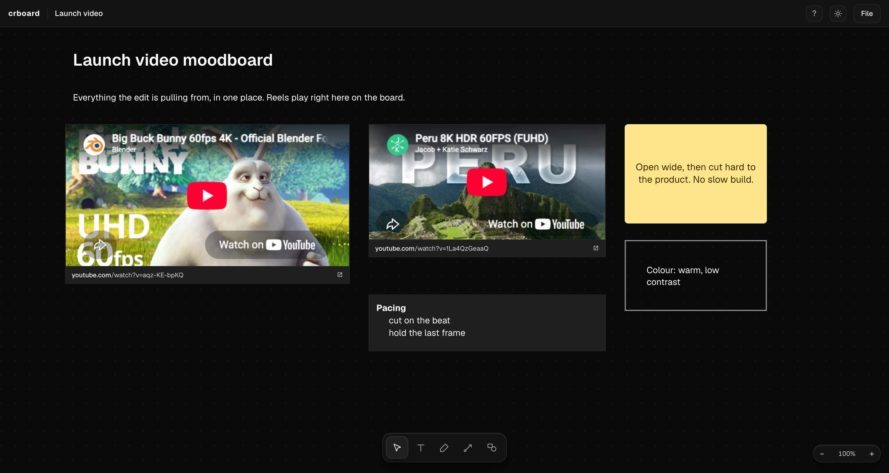

# flowboard

An endless canvas for flowcharts, diagrams, ideas, and media embeds that actually play.

> [!NOTE]
> **Credits & Acknowledgements**: flowboard is built upon and extended from [crboard](https://github.com/newomp4/crboard) by [newomp4](https://github.com/newomp4) (Owen). All gratitude and appreciation to the original author for the elegant minimalist design and zero-backend canvas architecture.



Like a whiteboard, except with built-in flowchart power: decision diamonds, labelled connector arrows, snap alignment guides, and rich media embeds (Instagram reels, YouTube videos, audio waveforms) that play right on the board. When you are done, export vector SVGs, print-ready PDFs, high-res PNGs, or share a standalone HTML bundle.

No account, no sign up, and nothing leaves your browser.

**Live Demo**: [https://mukiprojects.github.io/flowboard/](https://mukiprojects.github.io/flowboard/)  
*(Original crboard demo: [https://newomp4.github.io/crboard/](https://newomp4.github.io/crboard/))*

---

## What you can do

- **Flowcharts & Diagrams**:
  - **Decision Diamonds**: Add diamond decision shapes with centered text and smart angled perimeter arrow-clipping.
  - **Connector Arrow Labels**: Attach text labels ("yes", "no", condition strings) directly to arrows. Labels stay anchored to the midpoint as steps move and route. Double-click any connector or label to edit.
  - **Alignment & Spacing**: Align left/centers/right/top/middle/bottom, distribute horizontally/vertically, and space by equal gaps between edges. Accessible from the floating bar, right-click context menu, or keyboard shortcuts (`Alt+H`, `Alt+V`).
  - **Snap Guides**: Dynamic alignment guides automatically appear when dragging items to snap edges and centers into place.
- **Rich Media & Content**:
  - Drop text, images, and drawings anywhere on a canvas that never runs out.
  - Paste links from YouTube, Vimeo, Spotify, TikTok, X, Reddit, Loom, or CodePen to embed interactive players.
  - Drop audio files for real interactive waveform cards.
  - Draw with pen strokes and add sticky notes.
- **Vector & Sharp Exports**:
  - **Export as SVG**: Clean, infinite-resolution standalone vector SVG files ready for Figma, Keynote, PowerPoint, and documents.
  - **Export as PDF**: Print-ready vector PDF document.
  - **Export as PNG**: 300 DPI high-resolution bitmap.
  - **Export shareable HTML**: Self-contained single-file bundle with an embedded micro-viewer that opens in any browser.
  - **Save as .flowboard**: Lightweight JSON files to save and reload anytime (backward-compatible with legacy .crboard files).

---

## Shortcuts

| Shortcut | Action |
|---|---|
| `V` `T` `P` `C` `S` | Select, Text, Pen, Connector, Shape |
| `Cmd Z` / `Shift Cmd Z` | Undo / Redo |
| `Cmd D` | Duplicate selection |
| `Cmd A` | Select all |
| `Cmd F` | Find on the board |
| `Cmd 0` / `Cmd 1` | Back to 100% / Fit everything on screen |
| `Cmd J` | Zoom to selection |
| `Alt H` / `Alt V` | Align horizontal / vertical centers |
| `Cmd ]` / `Cmd [` | Bring to front / send to back |
| `Space` + drag | Pan from any tool |
| Arrow keys | Nudge 1px (`Shift` + Arrow = 10px) |
| `Backspace` / `Delete` | Delete selection |
| Right-click item | Context menu (Align, Distribute, Duplicate, Order, Delete) |
| `?` | See full shortcuts list |

---

## Running locally

```bash
npm install
npm run dev
```

Open [http://localhost:5173/](http://localhost:5173/) in your browser.

---

## License & Credits

Flowboard enhancements and extensions © 2026. Built on [crboard](https://github.com/newomp4/crboard) by [newomp4](https://github.com/newomp4).
